# 训练任务：skillopt_searchqa_训练任务_20260531_100904

```mermaid
flowchart TB
    subgraph INIT["🟦 初始化"]
        I1["初始 Skill<br/>3 条规则 / 40 字符<br/>「仔细阅读上下文、提取答案、保持简洁」"] --> I2["按 split_dir 分割数据"]
        I2 --> I3["train=6 / val=2 / test=2"]
        I3 --> I4["baseline 评估 → selection=50% / test=50%"]
    end

    INIT --> EPOCH1

    subgraph EPOCH1["🟨 EPOCH 1（num_epochs=2）"]
        direction TB

        subgraph STEP1["STEP 1 — epoch=1, step_in_epoch=0  ⏱48.5s"]
            S1A["① ROLLOUT<br/>抽 4 道题 → 答对 1/4 = 25%<br/>1 failure_patch + 1 success_patch"]
            S1B["② REFLECT<br/>analyst×2 → 分析错误轨迹<br/>⏱22s | 2.3k+3.6k tokens"]
            S1C["③ AGGREGATE<br/>2 patches → merge → 去重<br/>⏱13s | 866+2040 tokens"]
            S1D["④ SELECT<br/>5 edits → rank → 取 top 3<br/>⏱7s | 512+606 tokens"]
            S1E["⑤ UPDATE<br/>edit_budget=3 → 全部应用<br/>新 skill = 190 字符"]
            S1F["⑥ EVALUATE<br/>在 val/2 道题上跑 → EM=50%<br/>cand_score 没超过 current 50%"]
            S1G[["❌ REJECT<br/>skill 回退到 initial<br/>best_step 仍为 0"]]

            S1A --> S1B --> S1C --> S1D --> S1E --> S1F --> S1G
        end

        subgraph STEP2["STEP 2 — epoch=1, step_in_epoch=1  ⏱83s"]
            S2A["① ROLLOUT<br/>抽剩余题 → rollouts=38 calls 累计<br/>失败模式分析"]
            S2B["② REFLECT → AGGREGATE → SELECT → UPDATE"]
            S2C["⑥ EVALUATE → cand_score=50%"]
            S2D[["❌ REJECT<br/>current_score 仍为 50%"]]

            S2A --> S2B --> S2C --> S2D
        end

        STEP1 --> STEP2
        STEP2 --> SLOW1
    end

    subgraph SLOW1["🟩 SLOW UPDATE（Epoch 1 结束）"]
        L1A["对比：epoch0=initial vs epoch1=rejected<br/>同组样本纵向打分"]
        L1B["Optimizer 分析退化/改进模式<br/>⏱ 1 call | 2.6k+2.9k tokens"]
        L1C["注入经验指导<br/>写入 &lt;!-- SLOW_UPDATE_START --&gt;..."]
        L1C --> L1D["skill 当前 = slow_update_placeholder<br/>94 字符（含经验注释）"]

        L1A --> L1B --> L1C --> L1D
    end

    EPOCH1 --> SLOW1
    SLOW1 --> EPOCH2

    subgraph EPOCH2["🟨 EPOCH 2"]
        direction TB

        subgraph STEP3["STEP 3 — epoch=2, step_in_epoch=0  ⏱82s"]
            S3A["① ROLLOUT<br/>从 meta_skill/slow_update 出发<br/>重新抽样本作答"]
            S3B["② REFLECT → AGGREGATE → SELECT → UPDATE<br/>多轮分析，生成编辑"]
            S3C["⑥ EVALUATE → cand_score=50%"]
            S3D[["❌ REJECT<br/>skill 回退，best 仍未变"]]

            S3A --> S3B --> S3C --> S3D
        end

        subgraph STEP4["STEP 4 — epoch=2, step_in_epoch=1  ⏱48s"]
            S4A["① ROLLOUT<br/>仅抽 2 样本 → hard=0%<br/>只剩 1 个 failure_patch"]
            S4B["② REFLECT<br/>analyst×1 → 分析唯一错题<br/>⏱40s | 1.5k+5.3k tokens （深度分析）"]
            S4C["③ AGGREGATE → 0 calls / 无 merge"]
            S4D["④ SELECT → 2 edits → rank top 1"]
            S4E["⑤ UPDATE → 应用 1 条编辑<br/>新 skill=168 字符"]
            S4F["⑥ EVALUATE → cand_score=50%"]
            S4G[["❌ REJECT<br/>全部 4 步均 reject"]]

            S4A --> S4B --> S4C --> S4D --> S4E --> S4F --> S4G
        end

        STEP3 --> STEP4
        STEP4 --> SLOW2
    end

    subgraph SLOW2["🟩 SLOW UPDATE（Epoch 2 结束）"]
        L2A["对比 epoch1 vs epoch2<br/>生成最终经验"]
        L2B["skill 当前 origin = slow_update_epoch_02"]
    end

    EPOCH2 --> SLOW2
    SLOW2 --> FINAL

    subgraph FINAL["🟪 训练结束 — 总耗时 333.5s"]
        F1["best_skill = initial_skill（从未被超越）"]
        F2["test 评估：baseline=50% vs best=50% → Δ=0"]
        F3["total: 4 steps / 0 accepts / 4 rejects"]
        F4["tokens: 69k total（analyst 24k + rollout 23k + merge 7.5k）"]
        F1 --> F2 --> F3 --> F4
    end

    style REJECT fill:#fee2e2,stroke:#ef4444,color:#991b1b
    style ACCEPT fill:#dcfce7,stroke:#22c55e,color:#166534
    style S1G fill:#fee2e2,stroke:#ef4444,stroke-width:2px,color:#991b1b
    style S2D fill:#fee2e2,stroke:#ef4444,stroke-width:2px,color:#991b1b
    style S3D fill:#fee2e2,stroke:#ef4444,stroke-width:2px,color:#991b1b
    style S4G fill:#fee2e2,stroke:#ef4444,stroke-width:2px,color:#991b1b
    style INIT fill:#dbeafe,stroke:#3b82f6,color:#1e3a5f
    style FINAL fill:#f3e8ff,stroke:#9333ea,color:#4c1d95
    style SLOW1 fill:#dcfce7,stroke:#22c55e,color:#166534
    style SLOW2 fill:#dcfce7,stroke:#22c55e,color:#166534
```

## 关键数据

| 指标 | 值 |
|---|---|
| 训练样本 | train=6 / val=2 / test=2 |
| 初始 skill | 40 字符，3 条规则 |
| 总步数 | 4（2 epochs × 2 steps） |
| 接受/拒绝 | 0 accepts / 4 rejects |
| baseline → best | 50% → 50%（无提升） |
| test Δ | 0.0 |
| 总耗时 | 333.5s（~5.5min） |
| 总 token | 68,871 |
